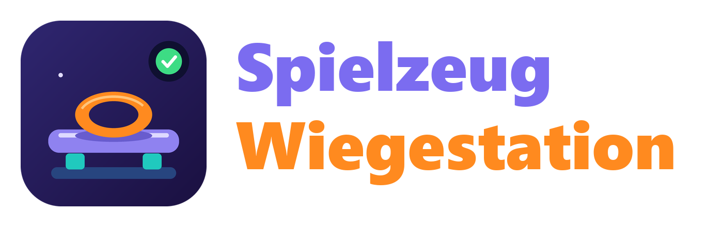

<p align="center">
  
</p>

# Toy weighing station for Home Assistant

[](https://github.com/RedDragonNode/ha-spielzeug-wiegestation/actions/workflows/tests.yaml)
[](https://github.com/RedDragonNode/ha-spielzeug-wiegestation/actions/workflows/hassfest.yaml)
[](https://github.com/RedDragonNode/ha-spielzeug-wiegestation/actions/workflows/hacs.yaml)

*[Deutsche Version](README.md)*

**A scale for toys.** An ESP32-P4 with Ethernet and PoE reads four load cells under one plate (one HX711 module each). Home Assistant calculates the weight, shows whether the scale is steady and whether something is on it, and calibrates itself through a wizard in the UI, without you having to flash the firmware again.

The project has two parts in one repo:

| Part | Where | What |
|---|---|---|
| **Firmware** (ESPHome) | [`esphome/`](esphome/README.md) | runs on the board and reports four raw values |
| **Integration** | `custom_components/spielzeug_wiegestation` | calculates tare, calibration, weight, "steady" and "occupied" |

> **Version 0.4.0:** The scale measures, calibrates, reports weight, steadiness and occupancy, and recognises taught toys by weight.

| You want to … | Use |
|---|---|
| see the weight on the plate | `Weight` (in grams) |
| know whether the scale is steady | `Scale steady` |
| know whether something is on the plate | `Occupied` |
| teach a toy | *Settings → Devices & services → Spielzeug Wiegestation → Teach a toy* |
| know which toy is on the plate | `Toys on the scale` and one sensor per toy |
| trigger something for a toy | the events `spielzeug_wiegestation_toy_placed` and `…_toy_removed` |
| subtract a tray or pad | the `Tare` button |
| calibrate the scale | *Configure → Calibrate the scale* |
| check whether a cell misbehaves | the disabled sensors `Weight cell 1` to `4` |

## Hardware

- **Board:** Waveshare ESP32-P4-ETH (with PoE module). The board has Ethernet only, no Wi-Fi.
- **Load cells:** four bar cells (5 kg each), each on its own **HX711** module. Together they carry up to about 20 kg.
- **Power:** PoE (IEEE 802.3af capable switch or injector) or USB-C.

> **Never connect PoE and USB at the same time.** Waveshare does not say whether the board tolerates both. To flash, unplug the network cable from the PoE port or plug the board into a normal network port.

### Wiring

Each HX711 module gets **3.3 V** (not 5 V). Data (`DT`) and clock (`SCK`) go to one pin of the board each:

| Cell | `DT` on the module to | `SCK` on the module to |
|---|---|---|
| 1 | `GPIO20` | `GPIO21` |
| 2 | `GPIO22` | `GPIO23` |
| 3 | `GPIO26` | `GPIO27` |
| 4 | `GPIO47` | `GPIO48` |

`VCC` of all modules goes to `3V3`, `GND` to `GND` of the board. The pins are on the right-hand header of the board, counted from the USB-C end: `VBUS`, `VSYS`, `GND`, `EN`, **`3V3`**, **`GPIO20`**, **`GPIO21`**, **`GND`**, `GPIO22`, `GPIO23`, `RUN`, `GPIO26`, `GND`, `GPIO27`, `GPIO32`, `GPIO33`, `GPIO46`, `GND`, `GPIO47`, `GPIO48`.

> **Mind the order:** On the HX711 module the row is usually `GND, DT, SCK, VCC`, on the board `3V3, GPIO20, GPIO21, GND` lie one below the other. A ribbon cable that simply connects both rows swaps 3V3 and GND and destroys the module. Connect each wire on its own, by name.

The cell connects to the module with four wires:

| Cell wire | Pin on the module |
|---|---|
| red | `E+` |
| black | `E−` |
| white | `A−` |
| green | `A+` |

That is the usual colour code. If a cell points the other way when you put a weight on it, `A+` and `A−` are swapped. That is not an error: the calibration wizard notices it and calculates a negative factor for that cell.

### Building the plate

- Each cell has a **fixed end** (with the two threaded holes, where the cable comes out) on the base and a **free end** that carries the plate. The free end needs **air** underneath, otherwise the cell cannot bend. Use spacers under the fixed end and above the free end.
- The arrow on the cell shows the direction in which the load should act.
- The four cells sit in the corners, all oriented the same way. The plate must be **stiff** and must not touch anything else.
- Never load a cell above 5 kg. Route the cables loosely and relieve the strain at the board.

## Installation

1. **HACS:** *HACS → ⋮ → Custom repositories*, add `https://github.com/RedDragonNode/ha-spielzeug-wiegestation` as **Integration**, install **Spielzeug Wiegestation** and restart Home Assistant.
2. **Firmware:** Set the board up with the firmware from [`esphome/`](esphome/README.md) (ESPHome Device Builder). The device file is only a few lines.
3. **Integration:** *Settings → Devices & services → Add integration → Spielzeug Wiegestation*. The four cells are suggested when the firmware from this project is running. All entities appear on the device page of the scale, next to the raw values.

## Calibrating

*Settings → Devices & services → Spielzeug Wiegestation → Configure → Calibrate the scale.* You need a weight whose mass you know exactly: 500 g to 1 kg is good (for example a pack of sugar or flour, a calibration weight or many coins). Below 100 g the calibration gets inaccurate.

1. **Empty plate:** take everything off, wait until the scale is steady and confirm. The scale remembers the zero point of each cell.
2. **Weight in the middle:** put the weight in the middle of the plate and enter its weight in grams. The scale is now calibrated, all four cells have the same factor.
3. **More accurate (optional):** put the same weight directly over each of the four cells in turn. From that the integration calculates (least squares over all five measurements) the factor of each cell separately. It reports the largest deviation. If it is above 3 %, nothing is saved, which points to a wobbling plate or a weight that slipped.

A cell that is wired the other way round is noticed by the wizard itself. Then only the measurement over each cell works.

You set the **tare** with the `Tare` button: put a tray on, press the button, the weight reads 0. Calibrating resets the tare.

## Recognising toys

The scale recognises toys by **weight** only, not by where they sit on the plate. When it has become steady, it compares its weight with that of the last steady period. The difference is what was put on or taken off. If it fits a taught toy (weight plus or minus tolerance), it is that toy.

**Teaching:** Put the toy alone on the scale and wait until `Scale steady` is on. Then *Settings → Devices & services → Spielzeug Wiegestation → Teach a toy*. The measured weight is already filled in, you only give it a name. The **tolerance** sets how far the weight may differ (empty = 5 % of the weight, at least 3 g). You can also enter a **description**, it belongs to the profile card. Every toy gets a sensor that is `on` while it lies on the plate. You change name, weight and tolerance on the toy's entry, and delete it there too.

- Put toys on one after the other, about two seconds apart, and take them off one after the other. Two toys put on together count as one unknown thing. If you take everything off at once, the scale reports each toy as removed separately.
- A toy below the "Occupied and recognition from" threshold (default 5 g) is not recognised.
- Two toys must not overlap (weight plus or minus tolerance). Otherwise teaching does not save them and names the other toy.
- After a load the empty plate creeps by a few grams. When nothing lies on it, the scale follows the zero up to 10 g so that "Occupied" does not get stuck.
- After a start the scale sees what already lies on the plate and remembers it without reporting.

### Events

On every change the scale sends an event on the Home Assistant bus. Automations can trigger on it, or you send a message with the **Own event** template of [Discord Hub](https://github.com/RedDragonNode/ha-discord-hub).

| Event | when |
|---|---|
| `spielzeug_wiegestation_toy_placed` | a taught toy was put on |
| `spielzeug_wiegestation_toy_removed` | a taught toy was taken off |
| `spielzeug_wiegestation_unknown_placed` | something was put on that fits no toy |
| `spielzeug_wiegestation_unknown_removed` | something unknown was taken off |
| `spielzeug_wiegestation_toy_taught` | a toy was taught |
| `spielzeug_wiegestation_toy_changed` | name, weight, tolerance or description of a toy was changed |
| `spielzeug_wiegestation_toy_deleted` | a toy was deleted |

Every event carries `weight` (the measured change in grams), `total` (the weight on the plate afterwards), `station` (name of the scale) and `entry_id`. For a taught toy `toy` (the name), `toy_id` and `thread_id` (the linked thread, otherwise empty) come with it. The events for teaching, changing and deleting carry the profile card: `toy`, `toy_id`, `weight` (the weight of the toy), `tolerance`, `description`, `taught_at` (date), `thread_id`, `station` and `entry_id`.

### Message on Discord

With [Discord Hub](https://github.com/RedDragonNode/ha-discord-hub) you send a message on every event, also with a picture from the camera that looks at the plate. You need no automation for it:

1. In Discord Hub choose *Add notice* and the template **Own event**.
2. Enter `spielzeug_wiegestation_toy_placed` as **Event** and choose your channel as **Target**.
3. **Title:** `{{ trigger.toy }} is on the scale`, **Text:** `{{ trigger.weight | round(0) }} g, at {{ now().strftime('%H:%M') }}`.
4. Switch on **Attach a snapshot of the camera** and choose the camera that looks at the plate as **Camera**.
5. For taking it off, add a second notice with `spielzeug_wiegestation_toy_removed`, preferably without a picture. For unknown things add a third with `spielzeug_wiegestation_unknown_placed` (title for example "Something unknown is on the scale", text `{{ trigger.weight | round(0) }} g`). There is no `trigger.toy` there.

The event comes when the scale has recognised the toy, so about two seconds after it was put on. The toy then lies still on the plate and the picture shows it. If the picture cannot be fetched, the message goes out anyway.

An automation gives more control, here for one toy only and with the picture attached:

```yaml
triggers:
  - trigger: event
    event_type: spielzeug_wiegestation_toy_placed
    event_data:
      toy: Teddy
actions:
  - action: discord_hub.send_message
    target:
      entity_id: notify.allgemein
    data:
      embeds:
        - title: "{{ trigger.event.data.toy }} is on the scale"
          description: "{{ trigger.event.data.weight | round(0) }} g"
          color: "#2ECC71"
          timestamp: true
      files: camera.spielzimmer
```

For messages use the events, not the toy sensors: when the integration reloads (when you teach, change or delete a toy), the sensors jump to `off` for a moment. An event does not fire then.

### One thread per toy in a Discord forum

With [Discord Hub](https://github.com/RedDragonNode/ha-discord-hub) every toy gets its own thread in a forum when you teach it, with a profile card and a picture from the camera. Later every placing and removing lands in exactly this thread. For this you need a bot in Discord Hub, the forum as a channel (*Discord Hub → Add channel*, in the example its `notify` entity is called `notify.spielzeug_forum`) and a camera that looks at the plate. In the forum the bot needs the permissions *Create posts*, *Send messages in threads* and, for archiving, *Manage threads*.

This is how it runs:

1. You put the toy on the scale and teach it. While you teach it the camera sees the toy on the plate, that is the picture for the profile card.
2. The integration sends the event `spielzeug_wiegestation_toy_taught`. The first automation creates the thread with it: the title is the name, the first post is the profile card with weight, tolerance, date and description, plus the camera picture.
3. Discord Hub answers with the `thread_id`. The service `spielzeug_wiegestation.set_toy_thread` remembers it with the toy, and it then appears in the events and in the `thread_id` attribute of the toy sensor.
4. The second automation writes every placing and removing into the thread. The third renames the thread when you change the toy, the fourth archives it when you delete it.

```yaml
# 1. Beim Anlernen: Thread mit Steckbrief und Kamerabild anlegen und merken
triggers:
  - trigger: event
    event_type: spielzeug_wiegestation_toy_taught
actions:
  - action: discord_hub.forum_post
    target:
      entity_id: notify.spielzeug_forum
    data:
      thread_name: "{{ trigger.event.data.toy }}"
      message: "Neues Spielzeug: {{ trigger.event.data.toy }}"
      embeds:
        - title: "{{ trigger.event.data.toy }}"
          description: "{{ trigger.event.data.description or '–' }}"
          color: "#2ECC71"
          fields:
            - name: "Weight"
              value: "{{ trigger.event.data.weight | round(0) }} g"
              inline: true
            - name: "Tolerance"
              value: "± {{ trigger.event.data.tolerance | round(0) }} g"
              inline: true
            - name: "Taught"
              value: "{{ trigger.event.data.taught_at }}"
              inline: true
      files: camera.spielzimmer
    response_variable: post
  - action: spielzeug_wiegestation.set_toy_thread
    data:
      toy_id: "{{ trigger.event.data.toy_id }}"
      thread_id: "{{ post['notify.spielzeug_forum'].thread_id }}"
```

```yaml
# 2. Verlauf: Auflegen und Wegnehmen als Nachricht in den Thread des Spielzeugs
triggers:
  - trigger: event
    event_type: spielzeug_wiegestation_toy_placed
  - trigger: event
    event_type: spielzeug_wiegestation_toy_removed
conditions:
  - condition: template
    value_template: "{{ trigger.event.data.thread_id != '' }}"
actions:
  - action: discord_hub.send_message
    target:
      entity_id: notify.spielzeug_forum
    data:
      thread_id: "{{ trigger.event.data.thread_id }}"
      message: >-
        {{ now().strftime('%H:%M') }} Uhr: {{ trigger.event.data.toy }}
        {{ 'is on the scale' if trigger.event.event_type.endswith('placed') else 'was taken off' }}
```

```yaml
# 3. Name, Gewicht oder Beschreibung geändert: Thread umbenennen
triggers:
  - trigger: event
    event_type: spielzeug_wiegestation_toy_changed
conditions:
  - condition: template
    value_template: "{{ trigger.event.data.thread_id != '' }}"
actions:
  - action: discord_hub.update_thread
    target:
      entity_id: notify.spielzeug_forum
    data:
      thread_id: "{{ trigger.event.data.thread_id }}"
      name: "{{ trigger.event.data.toy }}"
  - action: discord_hub.send_message
    target:
      entity_id: notify.spielzeug_forum
    data:
      thread_id: "{{ trigger.event.data.thread_id }}"
      message: "Profile updated: {{ trigger.event.data.weight | round(0) }} g, {{ trigger.event.data.description or '–' }}"
```

```yaml
# 4. Spielzeug gelöscht: Thread archivieren
triggers:
  - trigger: event
    event_type: spielzeug_wiegestation_toy_deleted
conditions:
  - condition: template
    value_template: "{{ trigger.event.data.thread_id != '' }}"
actions:
  - action: discord_hub.update_thread
    target:
      entity_id: notify.spielzeug_forum
    data:
      thread_id: "{{ trigger.event.data.thread_id }}"
      archived: true
```

## Entities

| Entity | Meaning |
|---|---|
| `sensor … Weight` | weight in grams after tare, `unknown` until calibrated |
| `binary_sensor … Scale steady` | the weight changed by no more than the tolerance within the set seconds |
| `binary_sensor … Occupied` | weight above the threshold (drops out only at 60 % of it, so it does not flicker) |
| `button … Tare` | sets the weight to zero |
| `sensor … Toys on the scale` | how many taught toys the recognition sees on the plate, the names are in the attributes |
| `binary_sensor … <name of the toy>` | `on` while this toy lies on the plate |
| `sensor … Calibration` (diagnostic) | `Calibrated` or `Not calibrated` |
| `sensor … Weight cell 1` to `4` (diagnostic, off) | weight each cell carries |

The raw values of the firmware appear on the device page as "Zelle 1" to "Zelle 4".

### Settings

*Configure → Set thresholds:*

| Setting | Default | Meaning |
|---|---|---|
| Steady after | 2 s | the weight may change by no more than the tolerance for this long |
| Tolerance for "steady" and display | 2 g | largest swing that still counts as steady. The displayed weight also only changes once it has moved by more than the tolerance |
| Occupied and recognition from | 5 g | from this weight the plate counts as occupied, and a change of this size counts as placing or removing a toy |

## Notes

- The raw values arrive about once a second when something changes, otherwise every 15 seconds. The integration keeps calculating with the last value. For the recorder it is worth excluding the four raw-value sensors and the cell weights from recording.
- No scale is ever perfectly still: the HX711 has a noise of about one gram. So that the `Weight` sensor does not write new values to the database all the time, it holds its value as long as the weight only varies by less than the tolerance, and settles on the mean once the scale is steady. If it shows 1 g off after you put a weight on, that is the tolerance, not a calibration error. For finer weighing, lower the tolerance.
- Without calibration the scale only calculates with a rough estimate, so "steady" already works during calibration. It shows the weight only afterwards.
- The calibration is stored in Home Assistant (not in the repo) and survives reloads and restarts. Deleting the integration removes it as well.

## Planned

- The plate to build yourself: drawings and 3D parts for the cell mounts.
- The toy sensors should no longer jump to `off` for a moment when the integration reloads.

## License

MIT, see [LICENSE](LICENSE).
