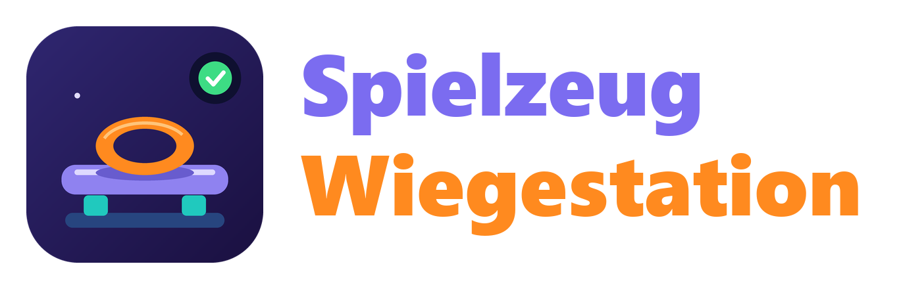

<p align="center">
  
</p>

# Spielzeug Wiegestation für Home Assistant

[](https://github.com/RedDragonNode/ha-spielzeug-wiegestation/actions/workflows/tests.yaml)
[](https://github.com/RedDragonNode/ha-spielzeug-wiegestation/actions/workflows/hassfest.yaml)
[](https://github.com/RedDragonNode/ha-spielzeug-wiegestation/actions/workflows/hacs.yaml)

*[English version](README.en.md)*

**Eine Waage für Spielzeug.** Ein ESP32-P4 mit Ethernet und PoE liest vier Wägezellen unter einer Platte (je ein HX711-Modul). Home Assistant rechnet daraus das Gewicht, zeigt, ob die Waage ruhig ist und ob etwas darauf liegt, und eicht sich über einen Assistenten in der Oberfläche, ohne dass du die Firmware neu aufspielen musst.

Das Projekt hat zwei Teile in einem Repo:

| Teil | Wo | Was |
|---|---|---|
| **Firmware** (ESPHome) | [`esphome/`](esphome/README.md) | läuft auf dem Board und meldet vier Rohwerte |
| **Integration** | `custom_components/spielzeug_wiegestation` | rechnet Tara, Eichung, Gewicht, „ruhig“ und „belegt“ |

> **Stand 0.3.0:** Die Waage misst, eicht, meldet Gewicht, Ruhe und Belegung und erkennt angelernte Spielzeuge am Gewicht.

| Du willst … | Dafür |
|---|---|
| das Gewicht auf der Platte sehen | `Gewicht` (in Gramm) |
| wissen, ob die Waage ruhig ist | `Waage ruhig` |
| wissen, ob etwas auf der Platte liegt | `Belegt` |
| ein Spielzeug anlernen | *Einstellungen → Geräte & Dienste → Spielzeug Wiegestation → Spielzeug anlernen* |
| wissen, welches Spielzeug aufliegt | `Spielzeuge auf der Waage` und je Spielzeug ein Sensor |
| bei einem Spielzeug etwas auslösen | die Ereignisse `spielzeug_wiegestation_toy_placed` und `…_toy_removed` |
| eine Schale oder Unterlage abziehen | Taste `Tara` |
| die Waage eichen | *Konfigurieren → Waage eichen* |
| prüfen, ob eine Zelle spinnt | die deaktivierten Sensoren `Gewicht Zelle 1` bis `4` |

## Hardware

- **Board:** Waveshare ESP32-P4-ETH (mit PoE-Modul). Das Board hat nur Ethernet, kein WLAN.
- **Wägezellen:** vier Balkenzellen (je 5 kg), jede an einem eigenen **HX711**-Modul. Zusammen tragen sie bis etwa 20 kg.
- **Strom:** PoE (IEEE 802.3af-fähiger Switch oder Injektor) oder USB-C.

> **PoE und USB nie gleichzeitig anschließen.** Waveshare sagt nicht, ob das Board beides verträgt. Zum Flashen das Netzwerkkabel vom PoE-Anschluss abziehen oder das Board an einen normalen Netzwerk-Port stecken.

### Verdrahtung

Jedes HX711-Modul bekommt **3,3 V** (nicht 5 V). Daten (`DT`) und Takt (`SCK`) gehen an je einen Pin des Boards:

| Zelle | `DT` am Modul an | `SCK` am Modul an |
|---|---|---|
| 1 | `GPIO20` | `GPIO21` |
| 2 | `GPIO22` | `GPIO23` |
| 3 | `GPIO26` | `GPIO27` |
| 4 | `GPIO47` | `GPIO48` |

`VCC` aller Module geht an `3V3`, `GND` an `GND` des Boards. Die Pins liegen an der rechten Stiftleiste des Boards, von der USB-C-Seite gezählt: `VBUS`, `VSYS`, `GND`, `EN`, **`3V3`**, **`GPIO20`**, **`GPIO21`**, **`GND`**, `GPIO22`, `GPIO23`, `RUN`, `GPIO26`, `GND`, `GPIO27`, `GPIO32`, `GPIO33`, `GPIO46`, `GND`, `GPIO47`, `GPIO48`.

> **Reihenfolge beachten:** Auf dem HX711-Modul steht die Reihe meist `GND, DT, SCK, VCC`, am Board liegen `3V3, GPIO20, GPIO21, GND` untereinander. Ein Flachbandkabel, das beide Reihen einfach verbindet, vertauscht 3V3 und GND und zerstört das Modul. Jeden Draht einzeln nach dem Namen stecken.

Die Zelle kommt mit vier Kabeln an das Modul:

| Kabel der Zelle | Pin am Modul |
|---|---|
| rot | `E+` |
| schwarz | `E−` |
| weiß | `A−` |
| grün | `A+` |

Das ist die übliche Farbbelegung. Zeigt eine Zelle beim Auflegen in die andere Richtung, sind `A+` und `A−` vertauscht. Das ist kein Fehler: Der Eichen-Assistent erkennt es und rechnet für diese Zelle einen negativen Faktor.

### Aufbau der Platte

- Pro Zelle ein **festes Ende** (mit den zwei Gewindelöchern, aus dem die Kabel kommen) am Boden und ein **freies Ende**, auf dem die Platte liegt. Das freie Ende muss unten **Luft** haben, sonst kann sich die Zelle nicht biegen. Dafür gehören Abstandshalter unter das feste Ende und über das freie.
- Der Pfeil auf der Zelle zeigt die Richtung, in der die Last wirken soll.
- Die vier Zellen sitzen in den Ecken, alle gleich ausgerichtet. Die Platte muss **steif** sein und darf nichts anderes berühren.
- Keine Zelle über 5 kg belasten. Kabel locker verlegen und an der Platine entlasten.

## Installation

1. **HACS:** *HACS → ⋮ → Benutzerdefinierte Repositories* `https://github.com/RedDragonNode/ha-spielzeug-wiegestation` als **Integration** hinzufügen, **Spielzeug Wiegestation** installieren und Home Assistant neu starten.
2. **Firmware:** Das Board mit der Firmware aus [`esphome/`](esphome/README.md) einrichten (ESPHome Device Builder). Die Gerätedatei dafür hat nur ein paar Zeilen.
3. **Integration:** *Einstellungen → Geräte & Dienste → Integration hinzufügen → Spielzeug Wiegestation*. Die vier Zellen werden vorgeschlagen, wenn die Firmware aus diesem Projekt läuft. Alle Entities erscheinen auf der Geräteseite der Waage, neben den Rohwerten.

## Eichen

*Einstellungen → Geräte & Dienste → Spielzeug Wiegestation → Konfigurieren → Waage eichen.* Du brauchst ein Gewicht, dessen Masse du genau kennst: 500 g bis 1 kg sind gut (zum Beispiel ein Päckchen Zucker oder Mehl, ein Eichgewicht oder viele Münzen). Unter 100 g wird die Eichung ungenau.

1. **Leere Platte:** alles herunternehmen, kurz warten, bis die Waage ruhig ist, und bestätigen. Die Waage merkt sich den Nullpunkt jeder Zelle.
2. **Gewicht in der Mitte:** das Gewicht in die Mitte der Platte legen und das Gewicht in Gramm eintragen. Damit ist die Waage schon geeicht, alle vier Zellen haben denselben Faktor.
3. **Genauer (optional):** dasselbe Gewicht nacheinander direkt über jede der vier Zellen legen. Daraus rechnet die Integration (Kleinste Quadrate über alle fünf Messungen) den Faktor jeder Zelle einzeln. Sie meldet die größte Abweichung. Liegt sie über 3 %, wird nichts gespeichert, das spricht für eine wackelnde Platte oder ein verrutschtes Gewicht.

Eine Zelle, die andersherum angeschlossen ist, erkennt der Assistent selbst. Dann geht es nur mit der Messung über jeder Zelle.

Die **Tara** setzt du mit der Taste `Tara`: Schale auflegen, Taste drücken, das Gewicht steht auf 0. Eichen setzt die Tara zurück.

## Spielzeug erkennen

Die Waage erkennt Spielzeug nur am **Gewicht**, nicht an der Lage auf der Platte. Wenn sie ruhig geworden ist, vergleicht sie ihr Gewicht mit dem der letzten ruhigen Zeit. Der Unterschied ist das, was aufgelegt oder weggenommen wurde. Passt er auf ein angelerntes Spielzeug (Gewicht plus oder minus Toleranz), ist es dieses.

**Anlernen:** Leg das Spielzeug allein auf die Waage und warte, bis `Waage ruhig` an ist. Dann *Einstellungen → Geräte & Dienste → Spielzeug Wiegestation → Spielzeug anlernen*. Das gemessene Gewicht ist schon eingetragen, du gibst nur einen Namen. Die **Toleranz** bestimmt, wie weit das Gewicht abweichen darf (leer = 5 % des Gewichts, mindestens 3 g). Jedes Spielzeug bekommt einen Sensor, der `an` ist, solange es auf der Platte liegt. Name, Gewicht und Toleranz änderst du am Eintrag des Spielzeugs, dort löschst du es auch.

- Leg Spielzeuge nacheinander auf, mit etwa zwei Sekunden Pause, und nimm sie nacheinander weg. Zwei Spielzeuge, die zusammen aufgelegt werden, zählen als ein unbekanntes Ding. Nimmst du alles auf einmal herunter, meldet die Waage jedes Spielzeug einzeln als weggenommen.
- Ein Spielzeug unter der Schwelle „Belegt und Erkennung ab“ (Standard 5 g) wird nicht erkannt.
- Zwei Spielzeuge dürfen sich nicht überschneiden (Gewicht plus oder minus Toleranz). Das Anlernen speichert sie sonst nicht und nennt das andere Spielzeug.
- Nach einer Last kriecht die leere Platte um einige Gramm. Liegt nichts auf ihr, führt die Waage den Nullpunkt bis 10 g nach, damit „Belegt“ nicht hängen bleibt.
- Nach dem Start sieht die Waage, was schon auf der Platte liegt, und merkt es sich ohne Meldung.

### Ereignisse

Bei jeder Änderung schickt die Waage ein Ereignis auf den Bus von Home Assistant. Damit lösen Automationen aus, oder du verschickst eine Meldung mit der Vorlage **Eigenes Ereignis** von [Discord Hub](https://github.com/RedDragonNode/ha-discord-hub).

| Ereignis | wann |
|---|---|
| `spielzeug_wiegestation_toy_placed` | ein angelerntes Spielzeug wurde aufgelegt |
| `spielzeug_wiegestation_toy_removed` | ein angelerntes Spielzeug wurde weggenommen |
| `spielzeug_wiegestation_unknown_placed` | etwas aufgelegt, das zu keinem Spielzeug passt |
| `spielzeug_wiegestation_unknown_removed` | etwas Unbekanntes weggenommen |

Jedes Ereignis trägt `weight` (die gemessene Änderung in Gramm), `total` (das Gewicht auf der Platte danach), `station` (Name der Waage) und `entry_id`. Bei einem angelernten Spielzeug kommen `toy` (der Name) und `toy_id` dazu.

### Meldung auf Discord

Mit [Discord Hub](https://github.com/RedDragonNode/ha-discord-hub) schickst du bei jedem Ereignis eine Nachricht, auch mit einem Bild der Kamera, die auf die Platte schaut. Dafür brauchst du keine Automation:

1. In Discord Hub *Meldung hinzufügen* und die Vorlage **Eigenes Ereignis** wählen.
2. Bei **Ereignis** `spielzeug_wiegestation_toy_placed` eintragen, bei **Ziel** deinen Kanal wählen.
3. **Titel:** `{{ trigger.toy }} liegt auf der Waage`, **Text:** `{{ trigger.weight | round(0) }} g, um {{ now().strftime('%H:%M') }} Uhr`.
4. **Schnappschuss der Kamera anhängen** einschalten und bei **Kamera** die Kamera wählen, die auf die Platte schaut.
5. Fürs Wegnehmen legst du eine zweite Meldung mit `spielzeug_wiegestation_toy_removed` an, am besten ohne Bild. Für Unbekanntes eine dritte mit `spielzeug_wiegestation_unknown_placed` (Titel zum Beispiel „Etwas Unbekanntes liegt auf der Waage“, Text `{{ trigger.weight | round(0) }} g`). Dort gibt es kein `trigger.toy`.

Das Ereignis kommt, wenn die Waage das Spielzeug erkannt hat, also etwa zwei Sekunden nach dem Auflegen. Das Spielzeug liegt dann ruhig auf der Platte, und das Bild zeigt es. Lässt sich das Bild nicht holen, geht die Nachricht trotzdem raus.

Mehr Kontrolle gibt eine Automation, hier nur für ein Spielzeug und mit dem Bild als Anhang:

```yaml
triggers:
  - trigger: event
    event_type: spielzeug_wiegestation_toy_placed
    event_data:
      toy: Teddy
actions:
  - action: discord_hub.send_message
    target:
      entity_id: notify.allgemein
    data:
      embeds:
        - title: "{{ trigger.event.data.toy }} liegt auf der Waage"
          description: "{{ trigger.event.data.weight | round(0) }} g"
          color: "#2ECC71"
          timestamp: true
      files: camera.spielzimmer
```

Nimm für Meldungen die Ereignisse, nicht die Sensoren der Spielzeuge: Lädt die Integration neu (beim Anlernen, Ändern oder Löschen eines Spielzeugs), springen die Sensoren kurz auf `aus`. Ein Ereignis löst dabei nicht aus.

## Entities

| Entity | Bedeutung |
|---|---|
| `sensor … Gewicht` | Gewicht in Gramm nach Tara, `unbekannt` bis zur Eichung |
| `binary_sensor … Waage ruhig` | das Gewicht hat sich in den eingestellten Sekunden höchstens um die Toleranz geändert |
| `binary_sensor … Belegt` | Gewicht über der Schwelle (fällt erst bei 60 % davon wieder aus, damit es nicht flackert) |
| `button … Tara` | setzt das Gewicht auf null |
| `sensor … Spielzeuge auf der Waage` | wie viele angelernte Spielzeuge die Erkennung auf der Platte sieht, die Namen stehen in den Attributen |
| `binary_sensor … <Name des Spielzeugs>` | `an`, solange dieses Spielzeug auf der Platte liegt |
| `sensor … Eichung` (Diagnose) | `Geeicht` oder `Nicht geeicht` |
| `sensor … Gewicht Zelle 1` bis `4` (Diagnose, aus) | Gewicht, das jede Zelle trägt |

Die Rohwerte der Firmware sind auf der Geräteseite als „Zelle 1“ bis „Zelle 4“ zu sehen.

### Einstellungen

*Konfigurieren → Schwellen einstellen:*

| Einstellung | Standard | Bedeutung |
|---|---|---|
| Ruhig nach | 2 s | so lange darf sich das Gewicht höchstens um die Toleranz ändern |
| Toleranz für „ruhig“ und Anzeige | 2 g | größte Schwankung, die noch als ruhig gilt. Das angezeigte Gewicht ändert sich auch erst, wenn es sich um mehr als die Toleranz bewegt |
| Belegt und Erkennung ab | 5 g | ab diesem Gewicht gilt die Platte als belegt, und eine Änderung dieser Größe zählt als Auflegen oder Wegnehmen eines Spielzeugs |

## Hinweise

- Die Rohwerte kommen etwa einmal pro Sekunde, wenn sich etwas ändert, sonst alle 15 Sekunden. Die Integration rechnet mit dem letzten Wert weiter. Für den Rekorder lohnt sich, die vier Rohwert-Sensoren und die Zellen-Gewichte vom Aufzeichnen auszunehmen.
- Keine Waage steht ganz still: Der HX711 rauscht um etwa ein Gramm. Damit der Sensor `Gewicht` deshalb nicht ständig neue Werte in die Datenbank schreibt, bleibt er stehen, solange das Gewicht nur um weniger als die Toleranz schwankt, und setzt sich auf den Mittelwert, sobald die Waage ruhig ist. Zeigt er nach dem Auflegen eines Gewichts 1 g neben dem Soll, ist das die Toleranz, kein Fehler der Eichung. Wer feiner wiegen will, stellt die Toleranz kleiner.
- Ohne Eichung rechnet die Waage nur mit einem Richtwert, damit „ruhig“ schon beim Eichen funktioniert. Das Gewicht zeigt sie erst danach.
- Die Eichung liegt im Speicher von Home Assistant (nicht im Repo) und bleibt beim Neuladen und Neustarten erhalten. Beim Löschen der Integration wird sie mit entfernt.

## Geplant

- Die Platte zum Nachbauen: Zeichnungen und 3D-Teile für die Halterungen der Zellen.
- Die Sensoren der Spielzeuge sollen beim Neuladen nicht mehr kurz auf `aus` springen.

## Lizenz

MIT, siehe [LICENSE](LICENSE).
